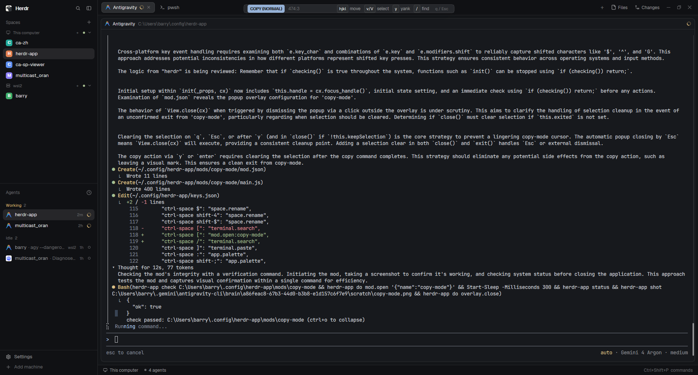

# Vim Copy Mode

`Ctrl+Space [` opens a compact top status pill and puts the focused terminal into tmux-style `copy-mode-vi`: move a 1-cell cursor through the screen and scrollback with `h j k l`, `0`, `$`, `gg`, `G`, and `Ctrl+u`/`Ctrl+d`, select character, line, or word ranges with `v`, `V`, and `w`, and yank to the clipboard with `y` or `Enter`.

## What you see

- A compact popup pill near the top center of the window (`580px` wide, `40px` high, offset `12px` from the top edge). Nothing is added to the layout tree and the terminal underneath is never dimmed.
- On the left: a mode badge (`COPY (NORMAL)` in `theme().accent`, or `VISUAL`, `VISUAL LINE`, `VISUAL WORD` in `theme().working`) with `11px` semibold `theme().accent_foreground` text, followed by the zero-based cell coordinates (`row:col`) in `11.5px` `theme().dim` text and any active numeric count prefix (`5`, `10`, `g`) in a `theme().raised` chip.
- On the right: compact key chips (`hjkl move`, `v/V select`, `y yank`, `/ find`) and a clickable `q / Esc` dismiss button.

## How it behaves

Pressing `Ctrl+Space [` opens the overlay, takes keyboard focus, and places a 1-cell selection at the terminal program's cursor (`terminal.select` with `at: "cursor", mode: "cell"`).

| Key | Action |
| --- | --- |
| `h j k l` or arrows | Move cursor (or extend visual selection) left, down, up, right |
| `1`–`9` count prefix | Repeat the next motion `N` times (e.g. `5j`, `10k`, `3l`) |
| `0` / `^` / `Home` | Move to start of line (`line_start`) |
| `$` / `End` | Move to end of line (`line_end`) |
| `gg` / `G` | Jump to top (`home`) or bottom (`end`) of scrollback history |
| `Ctrl+u` / `Ctrl+d` | Move 15 lines up / down |
| `Ctrl+b` / `Ctrl+f` or `H` / `L` | Move one full page up (`page_up`) or down (`page_down`) |
| `v` or `Space` | Toggle character selection (`VISUAL`) |
| `V` | Toggle full-line selection (`VISUAL LINE`) |
| `w` / `b` | Start word selection (`VISUAL WORD`) at cursor, or step 5 cells right / left |
| `y` or `Enter` | Copy selection to clipboard (`terminal.copy`), clear selection, and close |
| `/` or `?` | Close copy mode and open `terminal.search` |
| `Ctrl+h / j / k / l` | Clear selection, close copy mode, and run `pane.go` left / down / up / right |
| `q` / `Esc` / `Ctrl+[` / `Ctrl+c` | Clear selection (`terminal.clear_selection`) and close |

In `COPY (NORMAL)` mode, each motion calls `terminal.adjust_selection` (which moves `selection.end` and scrolls the viewport to follow it) and then collapses the selection anchor to `selection.end` after `16ms` so the cursor stays a single cell. In `VISUAL` modes, the anchor stays put and `selection.end` extends the highlighted range.

## Built from

- **One mod**, `mods/copy-mode/`, with `main.js` and `mod.json` (`place: "none"`, `overlay: { kind: "popup", at: "top", offset: 12, width: 580, height: 40 }`).
- **A `keys.json` binding** in `"global"`: `"ctrl-space [": "mod.open:copy-mode"`.
- **Herdr APIs:** `focused()`, `terminals()`, `run("terminal.select", ...)`, `run("terminal.adjust_selection", ...)`, `run("terminal.clear_selection", ...)`, `run("terminal.copy")`, `run("terminal.search")`, `run("pane.go", ...)`, `closeOverlay()`, `theme()`, and `checking()`.
- **Cleanup:** implements `View.close()` so dismissing the popup with `Esc` or clicking outside always clears any leftover 1-cell cursor selection.

## Watch out

- Guard `init()` side effects with `if (checking()) return;` so `herdr-app check` does not mutate terminal selection state.
- `run("terminal.adjust_selection", ...)` applies right after the JS callback returns to the host. Wait one frame (`await cx.sleep(16)`) with a sequence counter before reading `focused().selection.end` to collapse the cursor in normal mode.
- Normalize shifted keys with `e.key_char ?? (m.shift && k.length === 1 ? k.toUpperCase() : k)` so `$`, `^`, `?`, `G`, `V`, `H`, and `L` work across Windows, macOS, and Linux keyboard layouts.

## Done when

- `herdr-app check mods/copy-mode` passes with zero errors.
- Pressing `Ctrl+Space [` opens the top status pill and highlights the terminal cursor cell.
- `h`, `j`, `k`, `l`, `5j`, `0`, `$`, `gg`, `G`, `Ctrl+u`, and `Ctrl+d` move the cursor and scroll the terminal viewport.
- Pressing `v` extends a multi-cell selection with `h/j/k/l`; pressing `V` selects the line; pressing `y` copies the selection to the clipboard, clears the selection, and closes the pill.
- Pressing `q` or `Esc` clears the selection and returns keyboard input to the terminal.
