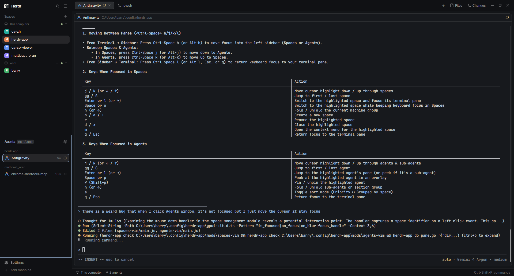

# Tmux + Vim Workflow (`main-vim`)

Tmux-style `<Ctrl-Space>` keybindings, Vim copy mode (`Ctrl-Space [`), top-center pickers (`picker-vim`, `palette-vim`, `help-vim`) with Vim navigation (`Ctrl-N/P`, `Ctrl-D/U`, `Ctrl-[`), and focusable **Spaces** and **Agents** sidebar panels that you can jump into with `Ctrl-Space h/j/k/l` and navigate using `h j k l`.

## What you see

- **Left sidebar (`268px` wide, `theme().chrome` background):**
  - Top header (`46px`, `workspace-chrome`): app brand, search button, and sidebar collapse toggle.
  - **Spaces pane (`spaces-vim`, weight 1, min `90px`):** spaces grouped by machine with worktrees nested under their main repository. When focused via `Ctrl+Space h` or clicking the pane background/header, it draws a `1px` `theme().accent` border, highlights the `Spaces` title in `theme().accent` with a `j/k · l/Enter` badge, and outlines the cursor-selected space row in `theme().accent`.
  - **Agents pane (`agents-vim`, weight 1, min `90px`):** agents in Priority or Grouped-by-space view with sub-agent trees. When focused, it draws a `1px` `theme().accent` border, highlights the `Agents` title in `theme().accent` with a `j/k · l/Enter` badge, and outlines the cursor-selected agent row in `theme().accent`.
  - Footer (`69px`, `workspace-chrome`): Settings and Add machine rows.
- **Right work column:**
  - Top tab bar (`42px`, `tabs`), main split terminal pane area (`padding: 8`, `gap: 8`, `radius: 10`), collapsible right `Files` / `Changes` stack (`368px`), the agent usage bar (`26px`, `agent-usage-vim`) and bottom status bar (`28px`, `workspace-status-vim`).
  - **Agent usage bar (`agent-usage-vim`, `26px`, `theme().chrome`, `11.5px` text):** for the focused terminal's agent (else another agent in the shown tab): its icon, `Claude Code · Opus 5.5` (or `Codex · <model>`, `Antigravity · <model>`), then its reasoning effort (`high`, `xhigh`, …) as a `10.5px` `theme().muted` chip on `theme().raised` with radius `4`, `Context: 25% (254k / 1M)`, and on the right `Limit: 5h 87% left (1h 59m) · 7d 65% left (2d 12h)`. Only the percentages (`25%`, `87%`) are colored, the rest of each label is `theme().muted`: `theme().foreground` while fine, `theme().ansi3` (yellow) at 60% context used or 20% limit left, `theme().ansi1` (red) at 85% used or 5% left. (Not `working`/`blocked`: those mean agent states.) Without an agent: `No active agent in this tab`. Without Python 3 on the agent's machine: `Agent usage needs Python 3 on <machine>`.
  - **Status bar (`workspace-status-vim`, `28px`):** shows machine name, git branch, agent count, blocked count, and the `Alt+Shift+P  commands` palette shortcut.

## How it behaves

- **Agent statuses:** working agents spin `mods/workspace-chrome/spinner.svg` in `theme().working`; blocked agents show a `Needs you` badge (or `!` in priority/compact mode) in `theme().blocked`; finished agents show a solid dot in `theme().done`; idle agents show a hollow ring in `theme().idle`.
- **Direct `<Ctrl-Space>` tmux prefix bindings:**
  - `Ctrl+Space` followed by `h/j/k/l` (or arrows) moves focus between panes and the sidebar (`pane.go`); `n/p` switches to next/prev tab; `( / )` or `K / J` switches to prev/next space; `< / >` moves the current tab left/right; `{ / }` swaps panes left/right.
  - `c` creates a tab, `1`–`9` selects a tab, `%` / `v` splits right, `"` / `s` splits down, `z` zooms, `x` / `q` closes a pane, `,` renames a tab, `&` closes a tab, `$` renames a space, `w` / `P` opens `picker-vim`, `[` opens Vim copy mode, `/` searches terminal output, `]` pastes, `:` opens `palette-vim`, `?` opens `help-vim`, `b` toggles the sidebar, `Ctrl-Space` sends NUL.
- **Sidebar Vim navigation (`Spaces` and `Agents`):**
  - `Ctrl+Space h` from the leftmost terminal pane moves focus into the sidebar (`Spaces` or `Agents`). `Ctrl+Space j` and `Ctrl+Space k` move between `Spaces` and `Agents`. `Ctrl+Space l`, `Esc`, or `q` moves focus back to the terminal pane.
  - Clicking a specific space or agent row switches to and focuses its terminal pane directly; clicking the sidebar pane background/header focuses that sidebar pane for keyboard navigation.
  - While focused in **Spaces**: `j`/`k` moves the cursor, `gg`/`G` jumps to first/last, `Enter`/`l` switches to the highlighted space and focuses its terminal, `Space`/`o` switches space while keeping focus in `Spaces`, `n`/`a`/`+` creates a space (on that space's machine), `r` renames, `d`/`x` closes, `m` opens the space menu. Once more than one machine is shown, each machine header is a cursor stop too (accent outline): `h` on a space folds its machine and moves the cursor to the header; on a header `h` folds, `l` unfolds (or steps into the first space), `Enter`/`Space`/`o` toggle, `n` makes a space on that machine. With only this computer there are no headers and `h` does nothing.
  - While focused in **Agents**: `j`/`k` moves through group headers, agents and sub-agents, `gg`/`G` jumps to first/last, `Enter`/`l` focuses the agent's pane (or peeks at an unkept sub-agent), `Space`/`p` peeks, `P` pins/unpins, `s` toggles sort mode (`Priority` ↔ `Grouped by space`). `h` folds an agent's open sub-agents; otherwise it folds what holds the cursor (a sub-agent's parent, an agent's group) and moves the cursor there. On a group header `h` folds, `l` unfolds (or steps in), `Enter` toggles; `l` on an agent with folded sub-agents unfolds them.
- **Agent usage bar:** refreshes every 4 s while the window is in front, and whenever the focused terminal, its agent, folder, pid, turn or status changes. Every 30 s it also asks about every agent and publishes their session titles in shared `"agent.titles"` (keyed by terminal address), which the Agents sidebar and picker show for untitled tabs; titles of ended terminals are dropped. Click the bar to refresh now. Terminals on other machines (`mac/t2`) are asked about on that machine.
- **Quick pickers & help at top center (`Alt+P`, `Alt+Shift+P`, `Ctrl+Space ?`):**
  - `Alt+P` (or `Ctrl+Space w` / `Ctrl+Space P`) opens `picker-vim` (space/tab/agent switcher).
  - `Alt+Shift+P` (or `Ctrl+Space :`) opens `palette-vim` (command palette).
  - `Ctrl+Space ?` (or `Ctrl+?`) opens `help-vim` (keybindings list).
  - All three open at the same top popup position (`offset: 40, width: 640`) and support `Ctrl+N` / `Ctrl+P` to select next/previous, `Ctrl+D` / `Ctrl+U` to scroll half a page down/up, and `Ctrl+[` or `Esc` to close.
- **Terminal Escape fix:** `"ctrl-[": "send:\u001b[27u"` in the `"terminal"` section of `keys.json` sends the Kitty keyboard protocol `Escape` sequence (`CSI 27 u`) so `Ctrl+[` acts as `Esc` inside TUI apps running in Kitty keyboard mode (e.g., Antigravity, Claude Code, Neovim). A plain `send:\u001b` did not work there. The bytes are fixed, not per program (see Watch out).

## Built from

- **Layout:** `layouts/main-vim.json` (cloned from `main`), wiring block `spaces` to `spaces-vim`, block `agents` to `agents-vim`, a new `26px` block `agent-usage` (above `status` in the `work` column) to `agent-usage-vim`, and block `status` to `workspace-status-vim`, plus shipped `workspace-chrome`, `tabs`, `pane`, `files`, and `changes`.
- **Mods:**
  - `mods/spaces-vim/` (`focusable: true` in `mod.json`): cloned from `spaces`, listening for `"focus"` on `nextCommand()`, tracking a `FocusHandle` on `#spaces-root`, and handling `h/j/k/l` in `on_key_down`.
  - `mods/agents-vim/` (`focusable: true` in `mod.json`): cloned from `agents`, listening for `"focus"` on `nextCommand()`, tracking a `FocusHandle` on `#agents-root` and a `ScrollHandle` on `#ag-list`, and handling `h/j/k/l` in `on_key_down`.
  - `mods/workspace-status-vim/` (`place: "none"`): cloned from `workspace-status`, displaying the `Alt+Shift+P  commands` shortcut for `palette-vim`.
  - `mods/copy-mode/` (`place: "none"`, top popup overlay `580x40` at offset `12px`): Vim copy mode using `terminal.select`, `terminal.adjust_selection`, `terminal.clear_selection`, and `terminal.copy`.
  - `mods/picker-vim/`, `mods/palette-vim/`, `mods/help-vim/` (`place: "none"`, top popup overlays `640x0.8` at offset `40px`): top pickers and help reference with `Ctrl-N/P`, `Ctrl-D/U`, and `Ctrl-[` keybindings. The palette lists every theme from `themes()`.
  - `mods/agent-usage-vim/` (`place: "none"`, layout block `agent-usage`, `26px`, optional props `{ "claude_usage_api": false }`): `main.js` picks the target terminal, runs `hc get <address> --json` for the shown tab's terminals (every agent's every 30 s) to learn the foreground program, pid and folder, then runs `query.py` once per machine with `exec(python, [script, json], { on: machine })`. Python is found by trying `python` then `py` on Windows, `python3` then `python` elsewhere (`python3`, `python`, `py` on other machines). `query.py` (Python 3.7+, standard library only) reads, on the agent's machine:
    - Claude Code: `~/.claude/sessions/<pid>.json`, `~/.claude/projects/<slug>/<session>.jsonl` (slug: the folder path with every non-alphanumeric as `-`), `~/.claude/settings.json`, and the login in `~/.claude/.credentials.json` (macOS: Keychain item `Claude Code-credentials` via `security`), which it sends to `https://api.anthropic.com/api/oauth/usage` (User-Agent `herdr-agent-usage`, cached 60 s in `~/.config/herdr-app/data/agent-usage/`). `"claude_usage_api": false` skips that request; the bar then shows the plan and session cost.
    - Codex: `~/.codex/state_5.sqlite`, `~/.codex/sessions/**/rollout-*.jsonl`, `~/.codex/config.toml`.
    - Antigravity: `~/.gemini/antigravity-cli/` (settings, `cache/last_conversations.json`, `history.jsonl`, `brain/<id>/…/transcript.jsonl`, `presence/<id>.lock`).
    - Hook files `~/.config/herdr-app/data/agent-usage/<agy|claude>-term-<terminal>.json` written by `hook.py`, when wired.
  - `mods/agent-usage-vim/hook.py` (optional, per agent): a statusLine command that stores the agent's statusLine JSON per terminal (`HC_TERMINAL_ID`), sets the terminal title to the session title (`CONOUT$` on Windows, `/dev/tty` elsewhere), prints the title with `--title`, and deletes its week-old files hourly. Wire it in the agent's settings, e.g. Antigravity `~/.gemini/antigravity-cli/settings.json` or Claude Code `~/.claude/settings.json`: `"statusLine": { "type": "command", "command": "python3 ~/.config/herdr-app/mods/agent-usage-vim/hook.py --title" }` (`python` on Windows). With it, the bar shows the agent's own context window and usage.
  - On another machine, `main.js` writes `query.py` once per version to `~/.cache/herdr-agent-usage/query-<hash>.py` there (in 8000-character pieces through `python -c`, removing older copies) and runs that copy.
- **Keys:** `keys.json` merging default bindings with `<Ctrl-Space>` sequences, `"alt-p": "mod.open:picker-vim"`, `"alt-shift-p": "mod.open:palette-vim"`, and `"ctrl-[": "send:\u001b[27u"`.

## Watch out

- `this.handle.focus()` is applied by GPUI after the current JS callback returns. Schedule a follow-up `cx.notify()` after `25–35ms` (`watchFocus`) so `this.handle.is_focused()` renders `true` immediately without waiting for mouse hover events, and poll gently while `this.handle.is_focused()` is `true` so the focus ring clears as soon as focus leaves.
- Always call `run("pane.go", { direction: "right" })` when leaving a `"focusable": true` sidebar mod for the already-active terminal pane; calling `run("pane.focus", { pane })` alone on an already-focused pane leaves Herdr's `pane.go` state on the sidebar mod.
- Guard all `init()` tasks and commands with `if (checking()) return;` after initializing instance fields so `herdr-app check` passes cleanly.
- `spaces-vim` and `picker-vim` run `git` and `hc machine` as the shipped `spaces` and `picker` mods do.
- **`agent-usage-vim` reaches the network and runs programs**: Python and `hc` on each agent's machine, `security` on macOS, and a request to `api.anthropic.com` with the Claude Code login (turn off with `"claude_usage_api": false`). It reads the agents' files listed above and writes under `~/.config/herdr-app/data/agent-usage/` and, on other machines, `~/.cache/herdr-agent-usage/`. Tell the person before installing.
- Remote `exec` goes through the local `hc`, whose command line Windows caps at 32k characters: never pass `query.py`'s text as one argument (it is ~33k); copy it in pieces as above.
- Effort is what the agent recorded, never a model default (Claude Code ran Opus 5.5 at `high` where the API default is `medium`): Claude Code's latest assistant entry `effort` in the session transcript, else its statusLine `model.effort`; Codex's latest `turn_context` `effort` in the rollout, else `model_reasoning_effort` in `~/.codex/config.toml`; Antigravity's statusLine `model.effort`, else the `(XHigh)` suffix of its model name. Values are lower-cased with non-letters dropped (`XHigh` → `xhigh`). No chip when none is found.
- Context windows: without the statusLine hook, Claude's comes from the API docs (200K for Claude 3.x, Opus 4/4.1/4.5, Sonnet 4/4.5 and Haiku 4.5; 1M for later models and `[1m]`). Claude Code can work against a smaller window than the API's; wire `hook.py` for its exact numbers. Codex and Antigravity report their own.
- macOS: the first Keychain read may ask to allow `security`; over a remote session it can't ask, and the bar shows the plan from the session instead of limits.
- `Ctrl-[` sends `CSI 27 u` to every terminal program. Programs that never turned on Kitty keyboard mode may not read it as `Esc`; Herdr has no per-mode `send`, so unbind it if a shell misbehaves.
- Sidebar folds: header rows must be cursor stops; otherwise folding the group that holds the cursor leaves no key that can open it again.

## Done when

- `herdr-app check` passes on `mods/spaces-vim`, `mods/agents-vim`, `mods/workspace-status-vim`, `mods/agent-usage-vim`, `mods/copy-mode`, `mods/picker-vim`, `mods/palette-vim`, and `mods/help-vim`.
- With a Claude Code, Codex or Antigravity terminal focused, the usage bar shows its model, `Context: N% (used / window)` and its limits within a few seconds, on this computer and on a space on another machine; with a plain shell focused it shows `No active agent in this tab`.
- In `Agents`, `h` on an agent without sub-agents folds its group and outlines the group header; `l` opens it again.
- `herdr-app status` reports `"layout": "main-vim"` and `"errors": []`.
- `Ctrl+Space h` moves keyboard focus from the terminal into the left sidebar (`Spaces` or `Agents`) and immediately draws the `theme().accent` focus border; `Ctrl+Space j` and `Ctrl+Space k` move between `Spaces` and `Agents`; `j` and `k` move the row cursor inside the focused sidebar; `Enter` or `l` activates the highlighted item and returns focus to the terminal.
- Pressing `Alt+P`, `Alt+Shift+P`, or `Ctrl+Space ?` opens the top-center popup where `Ctrl+N`/`Ctrl+P` moves selection, `Ctrl+D`/`Ctrl+U` scrolls half a page, and `Ctrl+[` closes the popup.
- Pressing `Ctrl+Space [` opens the `COPY (NORMAL)` pill at the top of the window, navigates and selects terminal text with `h/j/k/l` and `v`/`V`, yanks with `y`, and exits cleanly on `q` or `Esc`.
